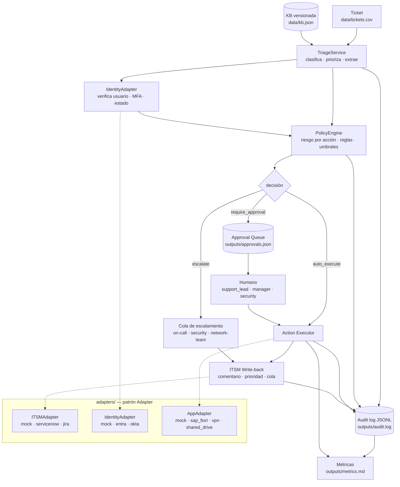

# AI Help Desk Triage & Remediation Agent

> **Agente de Help Desk que clasifica, prioriza, decide y deja rastro de auditoría — sin ejecutar nada que no pueda explicar.**
> *A triage-and-remediation Help Desk agent that classifies, prioritises, decides and leaves a full audit trail — without executing anything it cannot explain.*

---

## 1. Qué es esto / What this is

Un Help Desk de una empresa mediana recibe cientos de tickets por día. La mayor parte
son repetitivos: cuentas bloqueadas, contraseñas vencidas, permisos de carpeta, paquetes
de software, VPN caído. El 80 % del trabajo de un analista L1 es reconocer el patrón,
aplicar el procedimiento y documentarlo. El resto necesita criterio humano.

Este repositorio implementa esa parte repetitiva **de forma segura**: un agente que

1. **clasifica** el ticket contra una base de conocimiento versionada,
2. **prioriza** con una matriz impacto × urgencia,
3. **valida la identidad** del solicitante contra el directorio,
4. **evalúa el riesgo** de la acción propuesta (por acción, no por categoría),
5. **decide**: ejecutar solo, pedir aprobación humana, o escalar,
6. **deja rastro**: un log JSONL por evento, con las razones de cada decisión.

**The demo is deliberately deterministic**: no LLM, no external calls, zero installs.
Every decision is reproducible and explainable, and the evaluation harness proves it
with 28 labelled tickets.

### Disclaimer (literal)

> ITSM and identity integrations are mocked for demo purposes.
> The adapter pattern allows replacing mock connectors with ServiceNow, Jira Service Management, Azure AD or Okta APIs.

Nota en español: las implementaciones reales **existen** en `adapters/` (ServiceNow Table
API, Jira REST v3, Microsoft Graph para **Microsoft Entra ID / Azure AD**, Okta Management
API) y requieren credenciales explícitas; además, el kill-switch `HELPDESK_ALLOW_WRITES`
impide cualquier escritura no deseada en un sistema real.

---

## 2. Arquitectura / Architecture



Los tres adaptadores comparten la **misma forma de datos** (mocks y reales), de modo que
el runtime nunca sabe contra qué backend está hablando.

| Adapter | Mock | Real (implementado, requiere credenciales) |
|---|---|---|
| `ITSMAdapter` | `MockITSM` (lee `data/tickets.csv`) | `ServiceNowITSM` (`/api/now/table/incident`, `sys_journal_field`), `JiraITSM` (`/rest/api/3/issue/...`) |
| `IdentityAdapter` | `MockIdentity` (`data/users.json`, `data/groups.json`) | `EntraIDIdentity` (Microsoft Graph), `OktaIdentity` (Okta Management API) |
| `AppAdapter` | `MockApps` + variantes SAP Fiori / VPN / Shared Drive | — (extensible) |

---

## 3. Quickstart (cero installs)

Requiere **Python 3.9+**. Nada más.

```bash
git clone <este-repo> && cd ai-helpdesk-triage-agent

python3 agent.py --demo                                    # demo 5 min, dry-run, narrado
python3 agent.py --input data/tickets.csv --dry-run --verbose
python3 agent.py --input data/tickets.csv --verbose         # escribe al ITSM mock
python3 -m unittest discover -s tests -t . -v                # suite completa, 0 installs
python3 eval/run_eval.py                                     # eval harness + report
make help
```

`python3 -m unittest discover -s tests -t . -v` corre la suite completa sin instalar
nada: `requirements.txt` está íntegramente comentado a propósito.

Artefactos que deja la corrida:

```
outputs/triaged_tickets.json   outputs/triaged_tickets.csv   outputs/actions.json
outputs/approvals.json          outputs/audit.log            outputs/metrics.json
outputs/metrics.md              outputs/eval_report.md       outputs/eval_report.json
```

---

## 4. Cómo funciona / How it works

Diez pasos por ticket, cada uno con su evento de auditoría:

| # | Paso | Evento de auditoría | Resultado |
|---|---|---|---|
| 1 | Se normaliza el ticket y se validan los campos mínimos | `ticket_received` | ticket de entrada |
| 2 | `TriageService.classify()` — match contra la KB | `triage_completed` | categoría, intención, prioridad, confianza |
| 3 | `identity.get_user(requester)` | `identity_checked` | usuario, MFA, VIP, estado de la cuenta |
| 4 | `PolicyEngine.evaluate()` | `policy_decided` | riesgo, factores, regla, rol aprobador |
| 5 | Se arma el payload de la acción | `action_proposed` | acción + destino + recurso |
| 6 | Si `require_approval` → se crea la aprobación (**no se ejecuta**) | `approval_created` | registro en `outputs/approvals.json` |
| 7 | Si `escalate` → se escala y se crea la aprobación | `escalation_raised` | cola `on-call` / `security` / `network-team` |
| 8 | Si `auto_execute` → se ejecuta (nunca con riesgo high/critical) | `action_executed` / `action_failed` | efecto sobre el mock |
| 9 | Write-back al ITSM: comentario, prioridad, cola, resolución | `itsm_writeback` | ticket actualizado |
| 10 | Se cierran los artefactos y las métricas | `run_completed` | `outputs/*` |

### Tabla de decisión por riesgo

El riesgo se evalúa **por acción** (no por categoría) y **sólo puede subir**, nunca bajar:

| Riesgo efectivo | Decisión | Quién aprueba | Auto-ejecución |
|---|---|---|---|
| `low` + confianza ≥ 0.70 + sin flags | `auto_execute` | — | sí |
| `low` + confianza < 0.70 (o flag) | `require_approval` | `support_lead` | no |
| `medium` | `require_approval` | `support_lead` | no |
| `high` | `require_approval` | `manager` | no |
| `critical` | `escalate` | `security` | nunca |

Suben el riesgo (nunca lo bajan): solicitante **VIP**, solicitante **inactivo**, recurso
**sensible**, confianza **< 0.45**, solicitante **sin MFA** y acciones de mínimo
privilegio con impacto alto (`grant_role`, `grant_folder_access`, `disable_user`).

---

## 5. Confianza explicable / Explainable confidence

La confianza no es un número mágico: es una fórmula auditable que el agente devuelve
despieceada en cada decisión.

```
weighted_matched = 2·(strong keywords matched) + 1·(keywords matched)
weighted_total   = 2·(strong keywords)        + 1·(keywords)
coverage         = weighted_matched / weighted_total
evidence         = min(1, weighted_matched / 3)
specificity      = 1.0 si hubo strong match, si no 0.6
service_bonus    = 0.05 si el servicio del ticket == el servicio del artículo

confidence = round(min(1, 0.50·coverage + 0.30·evidence + 0.20·specificity + service_bonus), 2)
```

Ejemplo real de la corrida (`TCK-001`):

```
matched strong : ['cuenta bloqueada']      matched weak: ['sap','fiori','login','entrar','credencial']
weighted_matched = 7     weighted_total = 18
coverage = 0.3889   evidence = 1.0   specificity = 1.0   service_bonus = 0.05
confidence = 0.50·0.3889 + 0.30·1.0 + 0.20·1.0 + 0.05 = 0.74  ->  KB001, account_locked
```

Umbrales: **≥ 0.70** habilita la auto-ejecución si el riesgo lo permite · **0.45–0.69**
siempre pasa por humano (`require_approval`) · **< 0.45** cae en `unknown` +
`human_review`.

---

## 6. Guardrails

1. **Allow-list de acciones** — sólo las 13 acciones canónicas; el resto se marca
   `action_not_allowed` y no se ejecuta.
2. **El texto del ticket es input no confiable** — alimenta el matching y la extracción
   de entidades, nunca una política ni un comando. Ninguna decisión se interpola desde
   el ticket (defensa ante prompt injection).
3. **Verificación de identidad out-of-band** — un reset de contraseña exige identidad
   verificada **y** MFA enrolada **y** cuenta activa; un desbloqueo exige verificación y
   está bloqueado si el bloqueo lo puso un administrador.
4. **Mínimo privilegio** — el riesgo se decide por acción; `grant_role`,
   `grant_folder_access` y `disable_user` nunca se auto-ejecutan.
5. **Allow-list de recursos** — una solicitud de acceso a un recurso fuera de
   `policies/access_policies.json` falla cerrado con `AdapterConfigError`.
6. **Idempotencia** — `action_id = sha256(user|action|resource)[:12]`: reprocesar un
   ticket no duplica el efecto.
7. **Kill-switch** — `HELPDESK_ALLOW_WRITES` debe valer exactamente `1` para que los
   conectores reales escriban; si no, responden `{"status":"skipped","reason":"writes_disabled"}`.
8. **Auditoría completa** — cada evento va a `outputs/audit.log` (JSONL) con actor,
   razones y `rule_ids`. No hay acciones sin log.

---

## 7. Métricas y evaluación / Metrics and evaluation

```bash
python3 eval/run_eval.py        # escribe outputs/eval_report.md y .json
python3 eval/run_eval.py --verbose
```

El harness corre el pipeline **real** (triage + identidad + política) sobre 28 tickets
etiquetados a mano, sin red, sin ejecutar acciones y sin escribir en el ITSM. Los
solicitantes son usuarios reales de `data/users.json` y cada ticket declara el contexto
de identidad de su escenario (VIP, sin MFA, bloqueado, inactivo), de modo que el
ground truth no depende de que el directorio cambie mañana.

| Métrica | Umbral | Resultado actual |
|---|---|---|
| `category_accuracy` | ≥ 0.85 | **1.00** |
| `priority_accuracy` | ≥ 0.80 | **1.00** |
| `action_accuracy` | ≥ 0.75 | **1.00** |
| `decision_accuracy` | ≥ 0.80 | **1.00** |
| `risk_accuracy` / `intent_accuracy` | — | 1.00 / 1.00 |
| `escalation_recall` | — | 1.00 |
| `auto_resolution_rate` | — | 0.21 (6/28) |

El gate es duro: si una métrica queda por debajo del umbral, el script imprime
`EVAL FAILED: <métrica> <valor> < <umbral>` y sale con **exit code 1**; `make eval`
propaga ese código. El reporte incluye las matrices de confusión (categoría, prioridad,
decisión), el breakdown por categoría y por riesgo, y el detalle de cada fallo con
*esperado vs. obtenido*.

Métricas de la corrida (`outputs/metrics.md`): tickets procesados, auto-resueltos,
requieren aprobación, escalados, categoría desconocida, latencias medias, MTTR proxy,
`deflection_rate`, `estimated_minutes_saved`, distribución por categoría/prioridad y
`cost_estimate_usd` (0.00 — no hay LLM).

### ⚠️ Qué prueban y qué no prueban estas métricas

Las cuatro métricas dan **1.00** y hay que explicarlo con honestidad:

- El set etiquetado (`eval/labeled_tickets.json`) fue escrito **al mismo tiempo que la
  base de conocimiento**. Mide, por lo tanto, la **consistencia interna** del pipeline
  (triage → identidad → política → decisión), no la *accuracy* sobre tickets reales de
  un cliente. Es un test de regresión, no un indicador de performance en producción.
- En producción los números van a ser **sensiblemente más bajos**: el lenguaje de los
  usuarios reales es más ruidoso, la KB está incompleta por definición y las políticas
  cambian con el negocio. La métrica honesta de partida no es la accuracy de
  clasificación sino el **deflection rate** y el **FCR** medidos sobre tickets reales.
- Lo que sí demuestra el 1.00 es lo que importa para una entrevista de ingeniería: que el
  *contrato* entre triage, identidad y política se cumple de punta a punta, que las
  decisiones son deterministas y reproducibles, y que **cualquier cambio de KB, regla o
  umbral que rompa el contrato se detecta en el CI con un gate que falla** (exit code 1).
- Para que el número sea creíble con datos reales: etiquetar tickets históricos de
  producción, correr este mismo harness sobre ellos, revisar los fallos caso por caso,
  y versionar la KB y las reglas en cada cambio. Ese es el paso siguiente, no algo que
  se simula acá.

> En una entrevista, la frase correcta es: *"the labelled set was authored alongside the
> knowledge base, so the metric proves pipeline consistency, not production accuracy; with
> real historical tickets I would expect lower numbers and I would measure them the same
> way."*

---

## 8. De mock a producción / From mock to production

Cinco pasos concretos, en orden:

1. **Configuración** — copiar `.env.example` a `.env` y setear
   `HELPDESK_ITSM_ADAPTER=servicenow`, `HELPDESK_IDENTITY_ADAPTER=entra`,
   `HELPDESK_APP_ADAPTER=sap_fiori`. Los conectores reales validan las credenciales
   **al construirse** (fail fast), no en el primer request.
2. **Secretos** — `.env` está en `.gitignore`; en producción, un secret manager
   (Vault, AWS Secrets Manager, Azure Key Vault) inyecta las variables. Nunca hay un
   secreto en el repo ni en los logs: `sanitize_secrets()` reemplaza
   `Authorization`, `password`, `token` y `client_secret` por `***`.
3. **Colas y ejecución** — reemplazar el fichero de aprobaciones por una cola real
   (ServiceNow Approval, Jira Service Management, RabbitMQ) y ejecutar las acciones
   desde un worker con reintentos y **circuit breaker**, no desde el proceso de triage.
4. **Observabilidad** — `outputs/audit.log` (JSONL) a un SIEM (Splunk, Elastic,
   Sentinel); `outputs/metrics.json` a Prometheus/Datadog (deflection rate, MTTR,
   escalado por cola, tasa de fallo de acciones). El `run_id` correlaciona todo.
5. **Evaluación continua** — el set etiquetado (`eval/labeled_tickets.json`) es un
   **contrato**: cada cambio de KB, de política o de modelo se mide contra él, con gate
   en CI. Un ticket real nuevo se etiqueta y entra al set.

Detalle técnico en [`docs/ARCHITECTURE.md`](docs/ARCHITECTURE.md).

---

## 9. Estructura del repo / Repository layout

```
ai-helpdesk-triage-agent/
├── agent.py                     # orquestador CLI (10 pasos por ticket)
├── adapters/                    # capa de integración  [B]
│   ├── base.py                  # ABCs, errores, dataclasses, HTTP con reintentos
│   ├── itsm.py                  # MockITSM · ServiceNowITSM · JiraITSM
│   ├── identity.py              # MockIdentity · EntraIDIdentity · OktaIdentity
│   ├── apps.py                  # MockApps (SAP Fiori / VPN / Shared Drive)
│   └── __init__.py              # build_itsm_adapter / build_identity_adapter / build_app_adapter
├── services/                    # triage · policy · approval · monitoring  [A]
├── policies/                    # risk_matrix · access_policies · escalation_rules  [A]
├── data/                        # tickets.csv · users.json · groups.json · kb.json  [A]
├── eval/                        # harness + set etiquetado  [B]
│   ├── labeled_tickets.json     # 28 tickets con ground truth
│   ├── metrics.py               # accuracy, confusion matrix, breakdown
│   └── run_eval.py              # corre el pipeline y aplica el gate
├── tests/                       # suite completa con unittest (sin pytest)
├── docs/                        # SPEC.md · ARCHITECTURE.md · INTERVIEW_PLAYBOOK.md
├── outputs/                     # artefactos generados (gitignored)
├── Makefile · requirements.txt · .env.example · .gitignore
```

---

## 10. Limitaciones (honestidad) / Limitations

- **Sin LLM.** La clasificación es determinista y heurística. Es una decisión
  *deliberada*: en Help Desk la explicabilidad vale más que la sofisticación. El README
  documenta dónde entraría un LLM (redactar y resumir, no decidir).
- **Sin UI.** Es una demo CLI: la UI no aporta valor probatorio.
- **Sin multi-tenancy ni RBAC del propio repo.**
- **Los ITSM y las identidades están mockeados** — el código real está escrito y
  revisado, pero no se ejecutó contra un tenant real (no hay credenciales, y no
  corresponde en una demo de entrevista).
- **La base de conocimiento es de 13 artículos.** En producción serían cientos, con
  versionado y proprietor.
- **`cost_estimate_usd = 0.0`** porque no se llama a ningún modelo.
- **No se ejecutó contra un tenant real.** Los conectores reales están escritos, con
  tests sobre sus contratos, pero no hay credenciales de ServiceNow/Jira/Entra/Okta en
  esta demo.

---

## 11. Licencia / License

Distribuido bajo **MIT License** — ver [`LICENSE`](LICENSE).

- Autor y copyright: **Lucas Giurastante** — `yurastantelucas@gmail.com`
- Contexto del repositorio: demo técnica preparada para la vacante de *Senior IT Support
  Engineer – AI & Help Desk Automation* (RH VISION).
- Guion de entrevista: [`docs/INTERVIEW_PLAYBOOK.md`](docs/INTERVIEW_PLAYBOOK.md).
