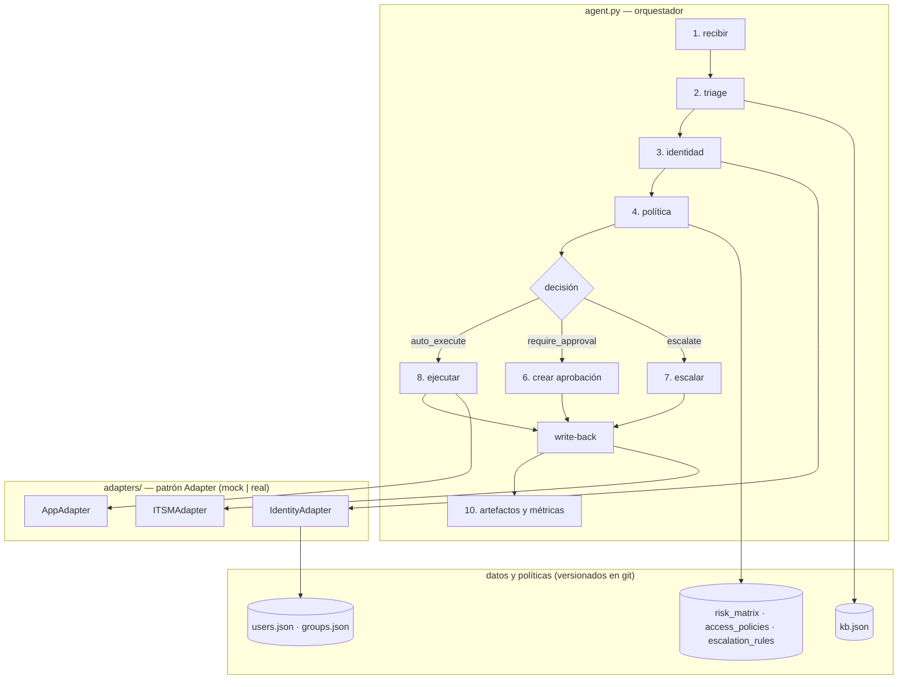
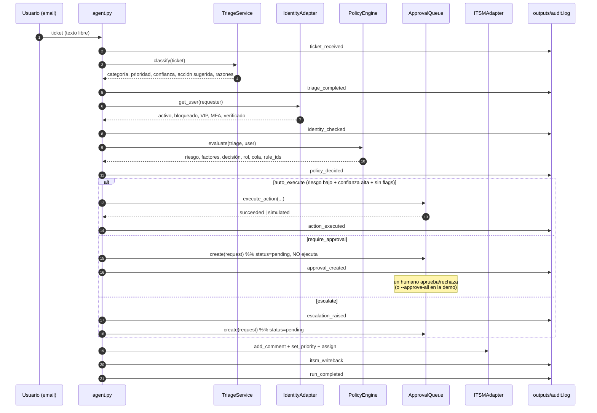

# Arquitectura / Architecture

> Documento de diseño del **AI Help Desk Triage & Remediation Agent**.
> Cubre el flujo end-to-end, las decisiones de diseño con su trade-off, los guardrails
> y el camino de mock a producción.

---

## 1. Flujo end-to-end

### 1.1 Contenedores

### 1.2 Secuencia de un ticket

---

## 2. Decisiones de diseño (ADR-lite)

| # | Decisión | Alternativa descartada | Trade-off | Dónde vive |
|---|---|---|---|---|
| ADR-1 | **Patrón Adapter** para ITSM / identidad / aplicaciones | Llamar a las APIs desde el agente | Más indirección, pero el runtime no cambia al cambiar de backend y los mocks son|first-class | `adapters/base.py` (ABC) |
| ADR-2 | **Clasificación determinista** (keywords ponderados) | LLM para clasificar | Pierde expresividad ante casos raros; gana auditabilidad, coste cero y reproducibilidad | `services/triage.py` |
| ADR-3 | **Riesgo por acción**, no por categoría | Derivar el riesgo de la categoría | Obliga a mapear 13 acciones; a cambio, "enviar un artículo" y "dar de alta un rol" dejan de compartir riesgo | `policies/risk_matrix.json` |
| ADR-4 | **Reglas estructuradas** (JSON con `field`/`op`/`value`) | Condiciones como strings con `eval()` | Menos flexible al escribir, infinitamente más seguro y testeable | `policies/escalation_rules.json` |
| ADR-5 | **HITL por umbral de riesgo** (no por umbral de confianza) | Confianza alta ⇒ ejecutar | Más gateway humano (7 de 12 tickets), pero ninguna acción de impacto se ejecuta sin una persona | `services/policy.py` |
| ADR-6 | **JSONL como audit trail** | Base de datos de auditoría | No hay consultas SQL, pero es append-only, grepeable y versionable en git | `outputs/audit.log` |
| ADR-7 | **Idempotencia por `action_id`** determinista | Re-ejecución libre | Obliga a derivar el id; a cambio, reprocesar un lote nunca duplica efectos | `sha256(user\|action\|resource)[:12]` |
| ADR-8 | **Kill-switch global** `HELPDESK_ALLOW_WRITES` | Permisos por rol | Un solo flag (fail-closed) gobierna todas las escrituras reales | `adapters/base.py` |
| ADR-9 | **Kill de LLM** (no hay LLM) | "Usar un LLM pero con cuidado" | Menos cobertura semántica; a cambio, el resultado es auditable y el coste es 0 | Decisión de producto, documentada en el README |

> Nota sobre ADR-5: el camino automático **existe** y está medido
> (`auto_resolution_rate = 0.22` en el set etiquetado, 2 de 12 en la corrida de demo).
> No es un agente que pide permiso por todo: es un agente que reserva el humano para
> lo que de verdad lo necesita.

---

## 3. Guardrails

| Amenaza | Mitigación | Dónde se implementa |
|---|---|---|
| **Prompt injection** en el texto del ticket | El texto sólo alimenta el *matching* de keywords y la extracción de entidades. Ninguna política, regla, comando ni decisión se interpola desde el ticket. | `services/triage.py` (normaliza y tokeniza), `services/policy.py` (sólo lee campos del contexto tipado) |
| **Agente que ejecuta algo destructivo** | Allow-list de 13 acciones canónicas; el riesgo es *por acción*; `high`/`critical` nunca se auto-ejecutan; las aprobaciones `high`/`critical` exigen `decided_by`. | `adapters/apps.py` (`ALLOWED_ACTIONS`), `services/policy.py`, `services/approval.py` |
| **Escalada de privilegios / identidad suplantada** | Reset de contraseña: identidad verificada **y** MFA **y** cuenta activa. Desbloqueo: identidad verificada y bloqueo no administrativo. El texto del ticket nunca "verifica" a nadie. | `adapters/identity.py` (`VerificationRequired`) |
| **Acceso a recursos no autorizados** | Allow-list de recursos en `policies/access_policies.json`; si el recurso no está, `AdapterConfigError` (fail closed). | `adapters/identity.py` (`request_access`) |
| **Escritura accidental en producción** | `HELPDESK_ALLOW_WRITES=1` exigido por los conectores reales; si no, responden `skipped/writes_disabled`. Sin credenciales, el conector ni siquiera se puede construir. | `adapters/base.py` (`writes_enabled`) |
| **Secreto filtrado a logs o artefactos** | `sanitize_secrets()` reemplaza `Authorization`, `password`, `token`, `client_secret` por `***` en todo lo que se persiste; `.env` está en `.gitignore`. | `adapters/base.py`, `.gitignore` |
| **Reintentos que amplifican un incidente** | Timeouts explícitos `(5, 15)`, máximo 3 intentos, backoff exponencial con jitter determinista, y **sin** reintento en 4xx (salvo 429). | `adapters/base.py` (`http_request`) |
| **Doble ejecución al reprocesar** | `action_id` determinista + `idempotency_key` en las aprobaciones + `duplicate_skipped` en las acciones. | `agent.py`, `services/approval.py` |
| **Decisión sin explicación** | `reasons` (no vacío) y `rule_ids` obligatorios en cada decisión de política; `score_breakdown` en cada clasificación. | `services/policy.py`, `services/triage.py` |
| **Fallo silencioso** | Todo error de integración va a `outputs/audit.log` como `integration_error`; el pipeline aísla el error del ticket y sigue con el lote. | `services/monitoring.py` |

---

## 4. De mock a real

| Mock (demo) | Real (producción) | Qué falta / cómo se resuelve |
|---|---|---|
| `MockITSM` sobre `data/tickets.csv` | `ServiceNowITSM` (`/api/now/table/incident`, `sys_journal_field`) o `JiraITSM` (`/rest/api/3/issue/...`) | Credenciales (token o API token), cuenta de servicio con RBAC mínimo, mapeo de `assignment_group` ↔ `accountId` de Jira, y un `sys_id` cacheado por ticket |
| `MockIdentity` sobre `data/users.json` | `EntraIDIdentity` (Microsoft Graph) u `OktaIdentity` (Okta Management API) | Token de aplicación (client credentials) gestionado por secret manager; scopes mínimos (`Directory.ReadWrite.All` o `User.ReadWrite`); para Entra, el *unlock* de lockout no está expuesto por Graph: se reporta `not_supported_by_graph` en vez de simular éxito |
| `MockApps` (simula) | SAP Fiori (RFC/OData), VPN (AnyConnect API), Shared Drive (Graph/Google Drive API) | Credenciales de servicio por aplicación, allow-list de acciones por aplicación y un worker que ejecute las acciones fuera del proceso de triage |
| `outputs/approvals.json` | Cola real (ServiceNow Approval, Jira Approval, RabbitMQ, ServiceNow Flow) | Persistencia transaccional, notificaciones (email/Slack/Teams) con enlace a la aprobación, expiración automática |
| `outputs/audit.log` (JSONL) | SIEM (Splunk / Elastic / Sentinel) | Envío estructurado con `run_id` y `ticket_id` como campos indexados, retención y control de acceso |
| `outputs/metrics.json` | Prometheus / Datadog | Exposición de métricas (deflection, MTTR, escalado por cola, fallos), alertas porSLO |
| Backoff exponencial en `http_request` | + **circuit breaker**, rate limiting por cola y DLQ | Un 429 sostenido hoy se traduce en 3 reintentos; en producción hace falta un breaker por servicio y una cola de reintentos |
| Ficheros JSON de entradas/salidas | Postgres + cola de mensajes | Transacciones, particionado por fecha y retención |

---

## 5. Performance y escalabilidad

- **Costo por ticket:** O(n) en longitud de texto (normalización + matching lineal sobre
  13 artículos). El batch de ejemplo es pequeño; este repositorio no mantiene un
  benchmark de rendimiento ni define un SLO.
- **Estado:** el runtime es *stateless* entre corridas; el estado persistente son
  artefactos en `outputs/`. Un ticket se puede reprocesar sin efectos duplicados.
- **Paralelismo:** el pipeline es embarrassingly parallel por ticket; el cuello de
  botella en producción son las llamadas a la API externa, no el cómputo.
- **Dónde entra un LLM:** (a) redactar el resumen para el usuario final, (b) traducir
  el ticket a un ticket en otro idioma, (c) *sugerir* un artículo de KB como candidato
  — nunca decidir la acción. El resto (clasificación, riesgo, decisión) sigue
  determinista, y el costo por ticket pasa de `0.0` a cents.

---

## 6. Limitaciones conocidas

- La KB tiene 13 artículos y el set etiquetado 28 tickets: suficiente para demostrar el
  mecanismo, insuficiente para medir precisión en producción. **El set se escribió junto
  con la KB, así que las métricas de `eval_report` miden consistencia interna del
  pipeline, no accuracy sobre tickets reales.** La métrica honesta de partida con datos
  de producción es el deflection rate y el FCR, no la accuracy de clasificación.
- El código de los conectores está incluido, pero **no se ejecutó contra un tenant real**
  (no hay credenciales). El repositorio incluye unit tests para el comportamiento de los
  adaptadores; esos tests no sustituyen pruebas de integración en un sandbox.
- `MockITSM` no persiste entre corridas y `MockApps` no ejecuta efectos reales: el
  write-back de la demo es en memoria.
- La política es plana (un archivo de riesgo, uno de escalamiento): en producción haría
  falta versionado por fecha y una evaluación "point in time" para poder auditar una
  decisión tomada hace seis meses con la política de ese día.
- El patrón de "2º ticket del mismo servicio en el lote ⇒ impacto de equipo" es
  heurístico y depende del orden del lote: en producción el impacto debería venir del
  catálogo de servicios y del grafo de dependencias, no del batch.
